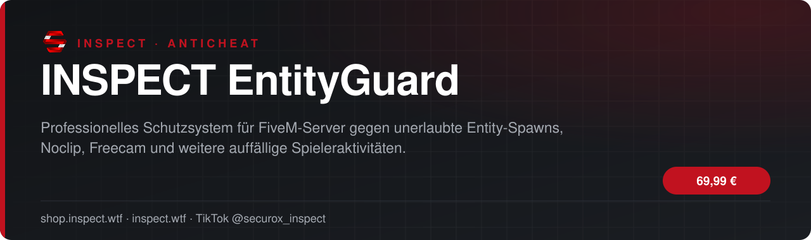
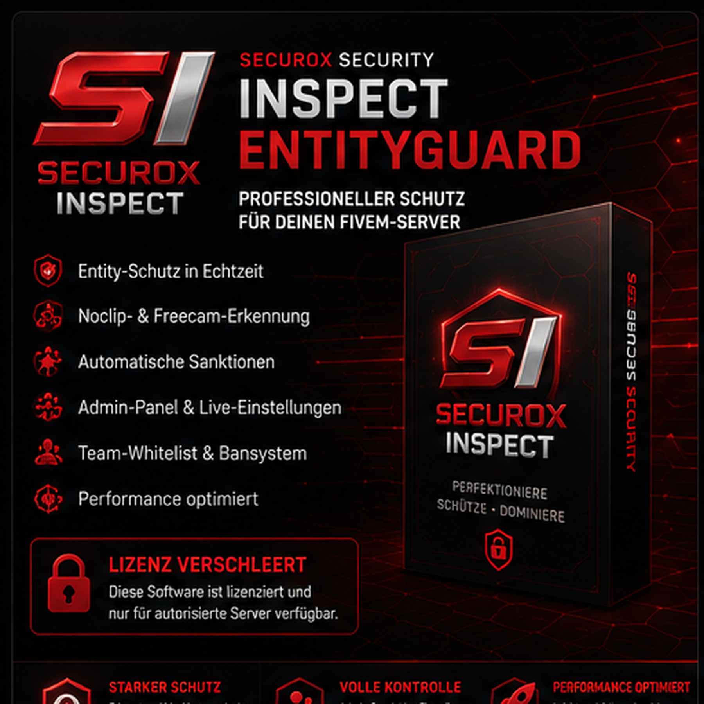

<!-- inspect-showcase: automatisch erzeugt, Änderungen bitte im Shop vornehmen -->

  
  
  
  
  

  
  
  

 

 

## Das Wichtigste auf einen Blick

<table>
  <tr>
    <td width="50%" valign="top">✔&nbsp; <b>Überwachung von Fahrzeug- und Objekt-Spawns</b></td>
    <td width="50%" valign="top">✔&nbsp; <b>Schutz vor auffälligen Massenspawns</b></td>
  </tr>
  <tr>
    <td width="50%" valign="top">✔&nbsp; <b>Automatisches Entfernen unerlaubter Entities</b></td>
    <td width="50%" valign="top">✔&nbsp; <b>Noclip- und Freecam-Erkennung</b></td>
  </tr>
</table>

## Überblick

#### MODERNER SCHUTZ FÜR DEINEN FIVEM-SERVER

INSPECT EntityGuard überwacht Fahrzeuge, Objekte und auffällige Spielerbewegungen in Echtzeit. Verdächtige Aktivitäten werden erkannt, protokolliert und abhängig von deiner Konfiguration automatisch blockiert oder sanktioniert.

#### ENTITY-SCHUTZ

Überwacht ungewöhnliche Fahrzeug- und Objekt-Spawns, entfernt unerlaubte Entities und schützt den Server vor Massenspawns und gezielten Störaktionen.

#### NOCLIP- UND FREECAM-ERKENNUNG

Erkennt auffällige Bewegungen, unerlaubtes Fliegen und ungewöhnliche Kameraentfernungen. Teammitglieder und berechtigte Funktionen können gezielt freigegeben werden.

#### AUTOMATISCHE SANKTIONEN

Das integrierte Bewertungssystem sammelt verdächtige Ereignisse und kann Spieler bei Überschreitung festgelegter Grenzwerte automatisch sperren.

#### ADMINISTRATION UND KONTROLLE

Über das Adminboard können Sperren, Whitelist-Einträge, Erkennungen und wichtige Einstellungen zentral verwaltet werden.

#### FLEXIBEL KONFIGURIERBAR

Grenzwerte, Schutzmodule, Whitelists, Benachrichtigungen und Sanktionen lassen sich an die Anforderungen deines Servers anpassen.

#### FÜR PRODUKTIVSERVER ENTWICKELT

INSPECT EntityGuard eignet sich für FiveM-Server, die einen übersichtlichen und erweiterbaren Schutz gegen Entity-Missbrauch und auffälliges Spielerverhalten benötigen.

#### HINWEIS

Kein Schutzsystem kann jede Manipulation vollständig ausschließen. INSPECT EntityGuard unterstützt dein Serverteam bei der Erkennung und Abwehr auffälliger Aktivitäten, ersetzt jedoch keine regelmäßige Kontrolle und sichere Serverkonfiguration.

## Kompatibilität

| | |
|:--|:--|
| Frameworks | **ESX** |
| Plattform | FiveM (GTA V) |

## Alle weiteren Funktionen

- Freecam-Erkennung
- Konfigurierbares Bewertungssystem
- Automatische Sperren nach Grenzwert
- Team- und Admin-Whitelist
- Zentrales Adminboard
- Sperren und Entsperren von Spielern
- Live anpassbare Schutzeinstellungen
- Protokollierung auffälliger Aktivitäten
- Discord-Benachrichtigungen
- Unterstützung für ESX

<b>2 weitere Funktionen anzeigen</b>

- Kompatibel mit oxmysql
- Einmaliger Kauf ohne zeitliche Lizenzlaufzeit

## Preis

**69,99 €** &nbsp;–&nbsp; einmaliger Kaufpreis · Download und Lizenz im Kundenkonto

Sichere Zahlung mit PayPal oder Kreditkarte · Rechnung als PDF · Support auf Deutsch

## So einfach geht's

1. **Im Shop kaufen** – sicher bezahlen mit PayPal oder Kreditkarte.
2. **Sofort loslegen** – Download und Lizenz stehen direkt nach Zahlungseingang in deinem Kundenkonto bereit, die Rechnung erhältst du als PDF.
3. **Einrichten** – bei Fragen hilft dir unser Support im Discord weiter.

## Warum INSPECT?

<table>
  <tr>
    <td width="50%" valign="top"><b>🇩🇪 Entwickelt in Deutschland</b> Konzeption, Entwicklung und Support aus einer Hand.</td>
    <td width="50%" valign="top"><b>💬 Persönlicher Support</b> Schnelle Hilfe auf Deutsch im INSPECT Discord.</td>
  </tr>
  <tr>
    <td width="50%" valign="top"><b>🔒 Sichere Zahlung</b> PayPal oder Kreditkarte, Rechnung automatisch als PDF.</td>
    <td width="50%" valign="top"><b>⚡ Sofort verfügbar</b> Download und Lizenz direkt nach der Zahlung im Kundenkonto.</td>
  </tr>
</table>

## Häufige Fragen

<b>Wie erhalte ich das Produkt?</b>

 

Nach bestätigter Zahlung stehen Download und Lizenz in deinem Kundenkonto bereit. Die Rechnung erhältst du als PDF.

<b>Welche Frameworks werden unterstützt?</b>

 

ESX.

<b>Bekomme ich Hilfe bei der Einrichtung?</b>

 

Ja – unser Support hilft dir im [INSPECT Discord](https://discord.gg/inspect) persönlich und auf Deutsch.

<b>Wo kaufe ich offiziell?</b>

 

Ausschließlich im INSPECT Shop unter [shop.inspect.wtf](https://shop.inspect.wtf). Angebote von Dritten stammen nicht von uns.

## Kontakt

| | |
|:--|:--|
| 🛒 Shop | [shop.inspect.wtf](https://shop.inspect.wtf) |
| 🌐 Website | [inspect.wtf](https://inspect.wtf) |
| 💬 Discord | [discord.gg/inspect](https://discord.gg/inspect) |
| 🎬 TikTok | [@securox_inspect](https://www.tiktok.com/@securox_inspect) |
| ✉️ E-Mail | [info@inspect.wtf](mailto:info@inspect.wtf) |

---

<b>SecuroX Inspect</b> · Offizielle Produktpräsentation · Dieses Repository enthält keinen Quellcode und keine Produktdateien. 
Kauf und Lizenzen ausschließlich über <a href="https://shop.inspect.wtf">shop.inspect.wtf</a> · Inhalte werden automatisch aus dem Shop aktualisiert.

